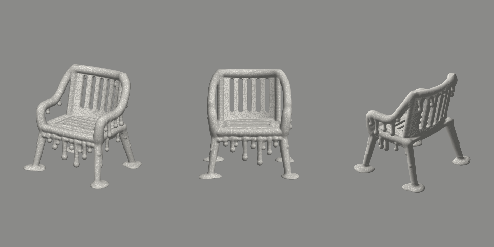

# Smältande stol – 3D-utskrift för Bambu Studio

| Fil | Innehåll |
|---|---|
| `melting_chair.3mf` | Öppna direkt i Bambu Studio (mm, Z upp, står på byggplattan) |
| `melting_chair.stl` | Samma modell som STL |
| `generate.py` | Parametrisk generator (SDF → marching cubes), kör om för att ändra detaljer |

**Mått:** ca 131 × 115 × 130 mm (B × D × H) · ca 132 cm³ solid volym · 450 k trianglar · vattentät, en enda kropp.

## Rekommenderade inställningar (PLA, 0,4 mm munstycke)
- **Lagerhöjd:** 0,12 mm (Fine) – droppar och rundningar blir mjuka. 0,16 mm går också.
- **Väggar:** 3 · **Infill:** 10–15 % gyroid.
- **Stöd:** *Tree (auto)*, tröskelvinkel 30°. Behövs under sitsen, armstöden, ryggstödets bakkant och under varje dropps runda spets. Alla droppar på sits och armar hänger fritt över byggplattan, så stödet blir lätt att bryta bort.
- **Platta:** fötterna är platta ”pölar” med stor kontaktyta – ingen brim behövs normalt.
- **Glans som på bilden:** vit silk-PLA, eller slipa + spraya med blank klarlack.

Uppskalning: modellen har ≥ 3 mm tjocka detaljer, så den kan skalas ned till ~60 % utan problem.
